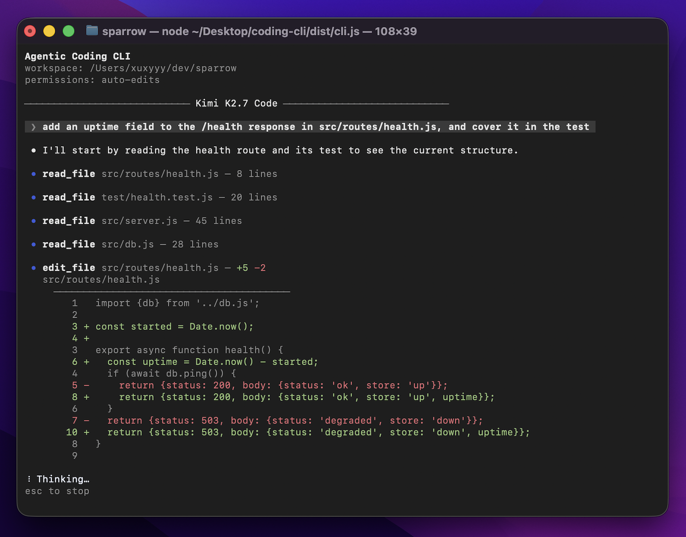

# acc

[](https://github.com/Xuxyyy/terminal-coding-agent/actions/workflows/test.yml)
[](LICENSE)

A terminal coding agent built from scratch in TypeScript. Describe a task in
plain English; `acc` searches your project, edits files, and runs commands.

Includes permission checks, resumable interactive sessions, automatic context
compaction, background commands, and subagents.

<p align="center">
  
</p>

## Quick start

Requires Node 22+, macOS or Linux (Windows through WSL), and
[ripgrep](https://github.com/BurntSushi/ripgrep) (`rg`) on your `PATH`.

Set `DEEPSEEK_API_KEY` in your shell before starting. Alternatively, copy
`.env.example` to `.env` in your project and fill in the key. ACC uses
DeepSeek V4.1 Flash (`deepseek-flash`) through the official API, with `high`
reasoning by default. See [model settings](docs/configuration.md#models-and-api-keys).

```bash
git clone https://github.com/Xuxyyy/terminal-coding-agent.git
cd terminal-coding-agent
npm install
npm link
cd ~/some-project
acc
```

`npm install` builds the CLI automatically. ACC is not published on npm.

**The workspace is the current directory.** Run `acc` inside your project;
it takes no path argument and refuses to start in your home directory or the
filesystem root. Describe your task at the interactive prompt.

## Behavior and limits

- **ACC edits files and runs shell commands.** The default `auto-edits` mode
  allows ordinary project edits and asks for approval above its automatic
  allowance threshold. A saved permission mode takes precedence.
- **Sandbox defaults to Off.** Permission checks still apply, but ACC's OS file
  and network restrictions do not. Sandbox On is supported only on macOS;
  enable it with `acc --sandbox on` or `/sandbox`. See [sandbox details](docs/sandbox.md).
- **Recovery is limited.** `/resume` reopens interactive sessions. `/rewind`
  restores conversation and file-tool backups; it does not undo shell changes.
- **Subagents run in the background by default.** They share your workspace,
  keep separate conversations, and support messages and saved follow-ups.
  See [subagents](docs/tools.md#agent).

See [commands](docs/commands.md) for
session and context controls, and [feature status](docs/features.md) for
current capabilities and known limits.

## Print mode

Run one task without an interactive terminal:

```bash
acc -p "summarize this project" --max-steps 120 --max-seconds 300
```

Defaults: **120 model turns** (including the final answer) and **300 seconds**.
Add `--json` for structured events and a final result. Confirmations are denied
unless `--yes` is passed; actions already allowed by the permission gate can
still edit files. Print runs do not save resumable sessions.
See [print mode](docs/headless.md) for details.

## Evaluation

**Terminal-Bench 2.1: 78/89 automated verifier passes (87.6%).**
See the [evaluation report](docs/terminal-bench-2.1-results.md) for settings,
task results, and sanitized evidence.

See [permission and CLI checks](docs/evals.md) for separate checks.

## Docs

Documentation lives in [docs/](docs/README.md).

- [Install](#quick-start)
- [Configuration](docs/configuration.md)
- [Architecture](docs/agent-loop.md)
- [Commands](docs/commands.md)

## Contributing

See [CONTRIBUTING.md](CONTRIBUTING.md).

## License

MIT — see [LICENSE](LICENSE).
